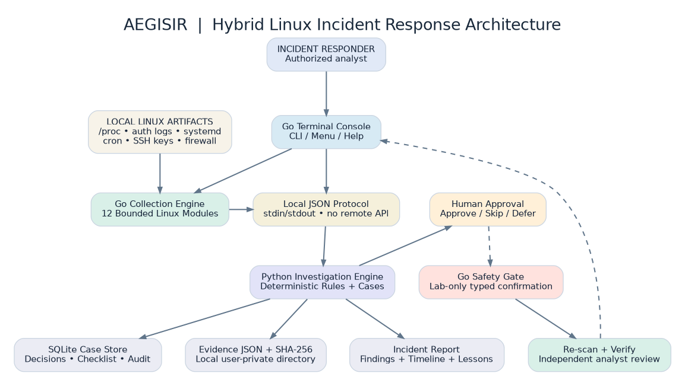
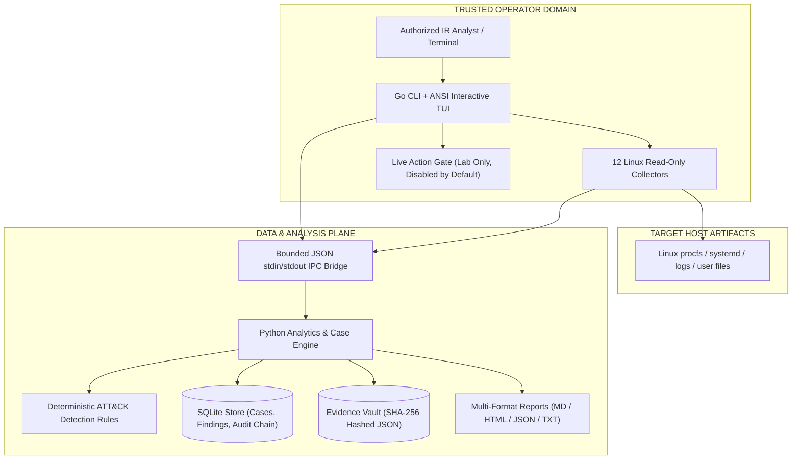
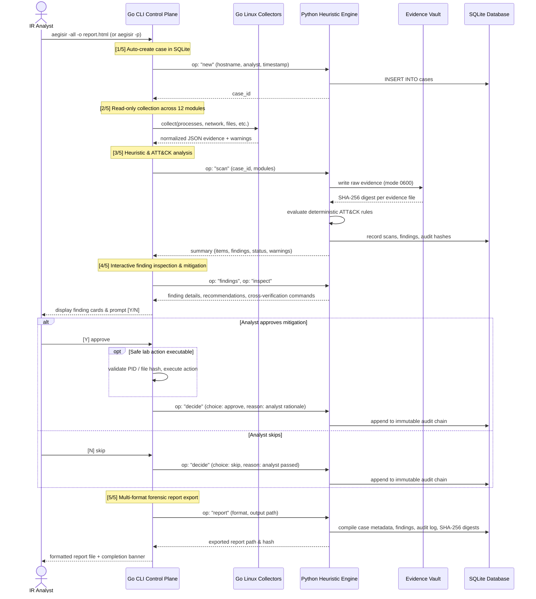
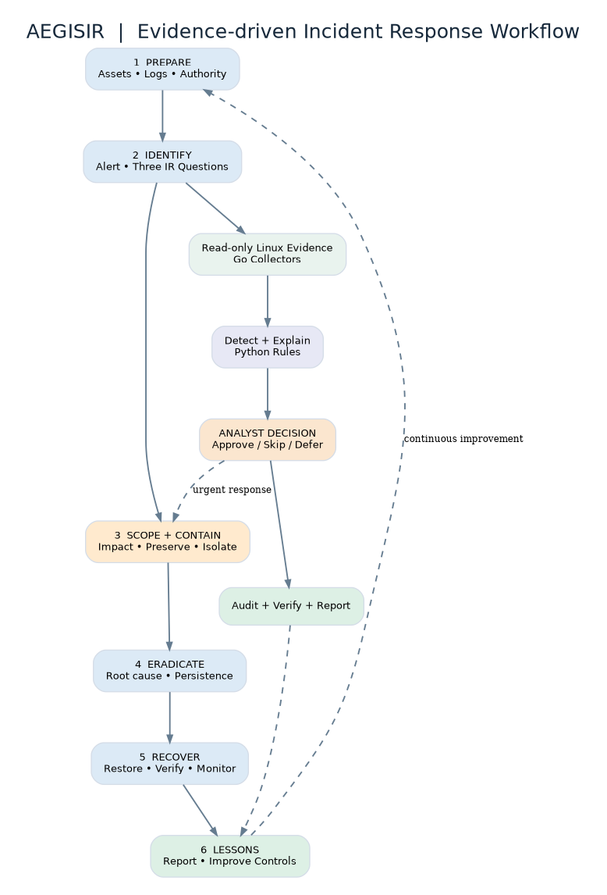
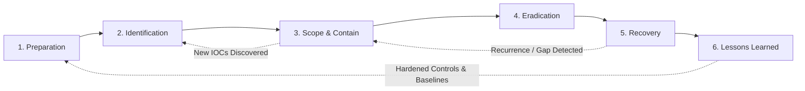

<div align="center">

```text
                             ╔═══════════════════════════════════════════════════════════╗
                             ║     █████╗ ███████╗ ██████╗ ██╗███████╗██╗██████╗         ║
                             ║    ██╔══██╗██╔════╝██╔════╝ ██║██╔════╝██║██╔══██╗        ║
                             ║    ███████║█████╗  ██║  ███╗██║███████╗██║██████╔╝        ║
                             ║    ██╔══██║██╔══╝  ██║   ██║██║╚════██║██║██╔══██╗        ║
                             ║    ██║  ██║███████╗╚██████╔╝██║███████║██║██║  ██║        ║
                             ╚═══════════════════════════════════════════════════════════╝
```

# AegisIR — Linux Incident Response & Forensic Workbench

**v0.2.0** · Read-only by default · No network listener · No root required · NIST SP 800-61 aligned

[](LICENSE)
[](https://go.dev)
[](https://python.org)
[](.)
[](#testing)
[](docs/)

</div>

---

## Overview

**AegisIR** is an offline-capable Linux incident response and forensic triage workbench built for authorized security analysts, SOC teams, and DFIR practitioners. It pairs a fast, statically-linked Go CLI (control plane) with an explainable Python analysis engine (data plane) to collect live forensic evidence, evaluate deterministic detection rules mapped to MITRE ATT&CK, manage incident cases, and generate tamper-evident reports — all with **zero third-party dependencies**, **no open network ports**, and **no background daemon**.

> **Designed for:** Security analysts, incident responders, SOC teams, and forensic engineers performing authorized live-host Linux triage.  
> **Not designed for:** Automated autonomous containment, enterprise multi-host orchestration, or unauthenticated deployment.

---

## Key Features

| Feature | Description |
|---|---|
| 🔍 **12 Forensic Modules** | Live processes, files, mounts, network sockets, users, systemd services, cron, SSH keys, shell profiles, auth logs, firewall policy, and IR readiness |
| 🛡️ **Read-Only by Default** | Non-destructive collectors use only read syscalls; no host modification without explicit analyst confirmation |
| 📊 **Multi-Format Reporting** | Export forensic cases into formatted Markdown (`.md`), SIEM-ready JSON (`.json`), executive HTML (`.html`), or plain text (`.txt`) |
| 🔐 **Tamper-Evident Evidence** | Cryptographic SHA-256 digests for every evidence snapshot and a hash-chained SQLite audit trail |
| 📋 **NIST IR Lifecycle** | Built-in 6-phase incident response workflow and tracking (Preparation → Identification → Scope/Containment → Eradication → Recovery → Lessons Learned) |
| 🧠 **MITRE ATT&CK Correlation** | Heuristic, explainable detection rules mapped directly to MITRE ATT&CK techniques |
| 💡 **13 Offline Guides** | Comprehensive built-in investigation playbooks with verification commands (`grep`, `ss`, `lsof`, `stat`, `systemctl`) |
| 🗃️ **SQLite Case Management** | Local case store tracking scans, findings, analyst decisions, reasons, and timelines |
| ⚡ **Zero External Dependencies** | Single static Go binary + standard Python 3.9+ runtime; requires no package installations or root privileges |

---

## System Architecture

AegisIR enforces strict operator-trust boundaries. The Go CLI acts as the interactive control plane, while the Python engine executes analysis, detection heuristics, and SQLite persistence. There is **no listening network socket** and no privileged server process.

### Architecture Overview



### Control Plane & Trust Boundaries



### Data Flow & Execution Sequence



### Architectural Planes

| Plane | Responsibilities | Security Boundaries |
|---|---|---|
| **Control Plane** | CLI flags, TUI interactive menus, workflow transitions, analyst confirmation prompts | Operates strictly with the analyst's unprivileged terminal permissions |
| **Data Plane** | 12 Go collectors, JSON evidence normalization, Python heuristic engine, SQLite findings | Bounded file sizes, execution timeouts, read-only syscalls |
| **Evidence Store** | Host snapshots stored under `~/.aegisir/evidence/` with SHA-256 digests | File permissions `0600`, directory `0700`, digest cross-verification |
| **Audit Plane** | Chained hash records of every scan, finding, note, and analyst decision in SQLite | Prevents retrospective modification of triage history |

---

## Incident Response Workflow

AegisIR implements an automated, analyst-centric incident response triage lifecycle aligned with **NIST SP 800-61 Rev. 3** and the **Cybersecurity Framework (CSF) 2.0**.





### Automated 5-Stage Live Triage Pipeline

Whenever a scan command is invoked (`aegisir -all`, `aegisir -p`, `aegisir -f`, etc.), AegisIR automatically executes a unified 5-stage triage pipeline:

1. **`[1/5]` Case Auto-Initialization:** Automatically provisions a new case in local SQLite, records target hostname, executing user, and timestamp.
2. **`[2/5]` Read-Only Evidence Collection:** Sweeps selected or all 12 modules using non-destructive syscalls, stores raw JSON in the evidence vault (`mode 0600`), and computes SHA-256 digests.
3. **`[3/5]` ATT&CK Rule Evaluation:** Correlates captured forensic evidence against deterministic detection rules mapped to MITRE ATT&CK techniques; outputs a module status summary table.
4. **`[4/5]` Finding Inspection & Interactive Mitigation:** Displays finding cards with observed evidence, confidence, and recommended cross-verification shell commands (`grep`, `ss`, `lsof`, `systemctl`), then interactively prompts the analyst:
   - `[Y]`: Records approval decision with analyst rationale in the audit log; prompts to execute bounded lab containment if qualified.
   - `[N]`: Records skip decision with rationale and returns to terminal.
5. **`[5/5]` Forensic Report Generation:** Compiles and exports the case report (`.html`, `.json`, `.md`, `.txt`) complete with cryptographic digests and audit hashes.

### Interactive Terminal UI Menu (`-ui`)

Running `aegisir -ui` (or launching `aegisir` with no arguments) provides an interactive ANSI menu:
- **Scan Operations:** Processes `[1]`, Files `[2]`, Mounts `[3]`, Network `[4]`, All 12 Modules `[5]`
- **Case Management:** Browse Past Cases `[6]`, Case Dashboard `[7]`, Case Timeline `[8]`, Verify Evidence Hashes `[9]`, NIST Checklist `[10]`
- **Diagnostics & Guides:** Synthetic Incident Demo `[11]`, System Doctor `[12]`, Module Directory `[13]`, Help Reference `[14]`

### 1. Preparation
Audit analyst environment, verify NTP synchronization, logging facilities, and collector health.
```bash
aegisir -doctor          # Verify environment, collector permissions, and dependencies
aegisir -guide readiness # Built-in IR readiness checklist and runbook
```

### 2. Identification
Triage host indicators and answer the **Three Critical IR Questions**:
1. **Is malware active?** — Inspect live processes, anomalous parent-child chains, deleted-binary executions.
2. **Is there suspicious communication?** — Identify unmapped listening sockets, foreign endpoints, non-standard port bindings.
3. **Is there persistence?** — Scan scheduled tasks (cron), systemd services/timers, SSH authorized keys, and shell init scripts.

### 3. Scope & Containment
Run forensic scans across all 12 modules or isolate investigation to specific attack vectors:
```bash
aegisir -all -o scope-report.json      # Comprehensive forensic capture
aegisir -network -process -file        # Targeted triage for suspicious activity
```

### 4. Eradication
Review detected findings, examine raw forensic evidence, and record explicit analyst decisions:
```bash
aegisir -cases                         # Review all active incidents
aegisir -show                          # Inspect findings for the current case
```

#### Finding Decision State Machine

```text
            ┌─────────┐
            │ PENDING │  ◄── Finding created upon rule match
            └────┬────┘
         ┌───────┼───────┐
         ▼       ▼       ▼
     ┌──────┐ ┌──────┐ ┌─────────┐
     │ SKIP │ │DEFER │ │ APPROVE │
     └──┬───┘ └──┬───┘ └───┬─────┘
        │        │         │
        │        └─────────┤
        │                  ▼
        │         ┌─────────────────┐
        │         │ ACTION ELIGIBLE │  (Lab/test environments only)
        │         └────────┬────────┘
        │                  ▼
        └────────►┌─────────────────┐
                  │ RECORDED DECISION│ ◄── Mandatory reason logged to audit chain
                  └─────────────────┘
```

### 5. Recovery & Verification
Verify that remediated artifacts are resolved and cryptographic integrity holds:
```bash
aegisir -verify                        # Cryptographically verify case evidence hashes
aegisir -checklist                     # Complete 6-phase NIST operational checklist
```

### 6. Lessons Learned & Export
Generate comprehensive post-incident documentation for technical and executive stakeholders:
```bash
aegisir -report -o final-report.html   # Executive summary with integrity proof
aegisir -timeline                      # Chronological event log
```

---

## Technical Documentation

Detailed engineering and architecture specifications are available in the [`docs/`](docs/) directory:

- 📋 **[Product Requirements Document (PRD)](docs/01-PRD.md)** — Core problem thesis, user personas (SOC L1–L3, DFIR), functional requirements, and design scope.
- 🏛️ **[System Architecture Specification](docs/02-SYSTEM-ARCHITECTURE.md)** — In-depth architectural decomposition, trust boundary definitions, process isolation, and component specifications.
- 🔄 **[Complete Incident Response Workflow](docs/03-WORKFLOW.md)** — Complete mapping to NIST SP 800-61 Rev. 3 / CSF 2.0, state machines, and module observation matrices.
- ⚙️ **[Technical Requirements & Standards](docs/06-TECHNICAL-REQUIREMENTS.md)** — Nonfunctional requirements, POSIX compliance, platform compatibility, and security boundaries.

---

## Collection Modules

All 12 modules are non-destructive and operate in **read-only mode**.

| Flag | Module | Forensic Evidence Collected | MITRE ATT&CK Relevance |
|---|---|---|---|
| `-p` / `-process` | Processes | PIDs, PPIDs, UIDs, command lines, binaries in `/proc`, parent-child hierarchy | T1059, T1055, T1543 |
| `-f` / `-file` | Files | Executables and scripts in `/tmp`, `/var/tmp`, `/dev/shm`; file permissions & hashes | T1105, T1036 |
| `-m` / `-mount` | Mounts | Mount points, remote NFS/CIFS shares, flags (`noexec`, `nosuid`, `ro`) | T1039, T1083 |
| `-n` / `-network` | Network | Active TCP/UDP listening ports, established sockets, socket inodes, owning PIDs | T1049, T1071 |
| `-u` / `-user` | Users | Local `/etc/passwd` users, non-root UID 0 accounts, sudo/wheel memberships | T1078, T1136 |
| `-s` / `-service` | Services | Systemd unit files, timers, active state, unit `ExecStart` binaries | T1543.002 |
| `-c` / `-cron` | Cron | System crontabs, `/etc/cron.*` directories, spool user crontabs | T1053.003 |
| `-k` / `-ssh` | SSH | Public key SHA-256 fingerprints in `authorized_keys`, root keys, sshd security config | T1098.004 |
| `-b` / `-bash` | Shell Profiles | User profile scripts: `.bashrc`, `.profile`, `.bash_profile`, `.bash_logout` | T1546.004 |
| `-l` / `-log` | Logs | Auth logs, journald entries, failed authentication attempts, sudo invocations | T1070.002 |
| `-fw` / `-firewall` | Firewall | iptables and nftables chains, policies, and active filtering rules | T1562.004 |
| `-r` / `-readiness` | Readiness | Host identity, NTP time synchronization, log visibility, tool permissions | Readiness Audit |

---

## Quick Start

### Prerequisites

- **Operating System:** Linux (x86_64 or aarch64) or Windows Subsystem for Linux (WSL2)
- **Runtime:** Python 3.9+ (pre-installed on almost all modern Linux distributions)
- **Privileges:** Standard user access (no `root` or `sudo` required for baseline triage)

### Installation

```bash
# Clone the repository
git clone https://github.com/shii9/AegisIR.git
cd AegisIR

# Build binary locally (requires Go 1.22+)
make build

# Or install for current user (~/.local/bin)
bash scripts/install.sh
```

### First Run & Verification

```bash
# 1. Run environment and collector diagnostics
./dist/aegisir -doctor

# 2. Run a safe synthetic demonstration (uses simulated data, zero host risk)
./dist/aegisir -demo

# 3. Launch the interactive ANSI terminal interface
./dist/aegisir -ui
```

---

## Command Reference

### General & Utility Commands

```bash
aegisir -h / -help        # Display full command help and options
aegisir -v / -version     # Display version and build information
aegisir -ui               # Open interactive numbered ANSI terminal menu
aegisir -doctor           # Check host environment and collector readiness
aegisir -demo             # Run an end-to-end simulated incident exercise
aegisir -modules          # Display status of all 12 collection modules
```

### Forensic Scanning

```bash
# Individual module scans
aegisir -process          # Inspect live processes and anomalous parentage
aegisir -file             # Inspect executables in writable directories
aegisir -network          # Inspect active sockets and listening ports
aegisir -user             # Audit user accounts and privileged groups
aegisir -service          # Inspect systemd units and timers
aegisir -cron             # Audit crontabs and scheduled jobs
aegisir -ssh              # Fingerprint authorized SSH keys
aegisir -bash             # Inspect shell startup scripts
aegisir -log              # Review recent authentication events and failures
aegisir -firewall         # Inspect active firewall rules
aegisir -mount            # Inspect mount flags and shared filesystems
aegisir -readiness        # Check system time and audit health

# Multi-module scans
aegisir -process -network -file -o triage.md

# Comprehensive 12-module scan
aegisir -all -o incident-report.html
```

### Output Formats

```bash
aegisir -all -o report.html          # Executive HTML report with styled metrics
aegisir -all -o report.md            # Markdown report for incident tickets and wikis
aegisir -all -o report.json          # Structured JSON for SIEM/SOAR ingestion
aegisir -all -o report.txt           # Clean plain text for email or console
aegisir -all -fmt json               # Explicitly set output serialization
```

### Case & Incident Management

```bash
aegisir -cases                       # List all incident cases in local database
aegisir -show                        # Display 3 Critical IR Questions for latest case
aegisir -show CASE-ID                # Display details for a specific case
aegisir -timeline                    # Display chronological event timeline
aegisir -checklist                   # Display 6-phase NIST operational checklist
aegisir -verify                      # Cryptographically verify evidence SHA-256 digests
aegisir -report -o final.html        # Export forensic report for latest case
aegisir -note "Investigated PID 404" # Attach timestamped analyst note to active case
```

---

## Investigation Playbooks

AegisIR contains 13 built-in offline investigation playbooks accessible directly from the terminal without internet access:

```bash
aegisir -guide process      # Process triage & memory execution playbook
aegisir -guide file         # Temp file and unauthorized executable investigation
aegisir -guide network      # Socket, port, and connection analysis
aegisir -guide user         # Privilege escalation and rogue account triage
aegisir -guide service      # Systemd service and timer persistence investigation
aegisir -guide cron         # Scheduled job persistence investigation
aegisir -guide ssh          # SSH authorized key forensics and backdoor analysis
aegisir -guide firewall     # Firewall rule tampering and evasion analysis
aegisir -guide logs         # Log review and anti-forensic tampering detection
aegisir -guide readiness    # Incident response readiness and preflight checklist
aegisir -guide workflow     # End-to-end NIST incident handling methodology
```

Each guide provides:
- **Core Investigation Objectives:** What to look for and attack hypotheses.
- **Evidence Collected:** Exactly which files and kernel structures are evaluated.
- **High-Risk Indicators:** Concrete warning signals that warrant immediate escalation.
- **Cross-Verification Shell Commands:** Exact Linux CLI commands (`stat`, `ss -tulpn`, `lsof -p`, `systemctl cat`) to independently confirm findings before taking action.
- **Containment & Remediation Checklist:** Step-by-step guidance for safe isolation.

---

## Security Model

### Trust Boundary Architecture

```text
┌──────────────────────────────────────────────────────────────────┐
│  TRUSTED BOUNDARY: Authorized Security Analyst + Terminal        │
│                                                                  │
│  ┌────────────────────────────────────────────────────────────┐  │
│  │  AegisIR Process (Standard Analyst Permissions)             │  │
│  │  • Go CLI Control Plane   • Python Heuristic Engine        │  │
│  │  • 12 Forensic Collectors • Local SQLite Storage           │  │
│  └────────────────────────────────────────────────────────────┘  │
│                                                                  │
│  UNTRUSTED BOUNDARY: Target Host Forensic Artifacts              │
│  • /proc entries   • Writable directories (/tmp)  • Log entries  │
│  • Public SSH keys • Shell scripts                • Network info │
└──────────────────────────────────────────────────────────────────┘
```

### Safety & Integrity Controls

| Security Control | Implementation Detail |
|---|---|
| **Non-Destructive Scanning** | Collectors invoke read-only system calls; no writes to `/proc`, `/sys`, or root directories. |
| **No Root Requirement** | Runs entirely under standard user credentials. Refuses root execution for live containment actions. |
| **Zero Network Attack Surface** | No listening ports, no HTTP services, and no RPC endpoints. Python is an isolated subprocess over stdin/stdout. |
| **Evidence Immutability** | Every raw collection file is hashed with SHA-256 upon capture. Evidence directory permissions are enforced as `0700`. |
| **Audit Log Chaining** | Analyst decisions, scan executions, and notes are appended to an internal SQLite hash chain to detect tampering. |
| **No Credential Harvesting** | By design, AegisIR never collects `/etc/shadow`, private SSH keys, or raw process environment variables. |
| **Fail-Safe Containment** | Containment actions are restricted to lab environments and require interactive typed confirmation. |

---

## Project Structure

```text
AegisIR/
├── .github/
│   └── workflows/
│       └── test.yml                 # CI test & lint pipeline
├── cmd/
│   └── aegisir/
│       ├── guide.go                 # 13 offline investigation playbooks
│       ├── main.go                  # CLI entrypoint, commands, and routing
│       └── tui.go                   # ANSI interactive terminal menu & dashboard
├── docs/
│   ├── 01-PRD.md                    # Product requirements & problem thesis
│   ├── 02-SYSTEM-ARCHITECTURE.md   # Architectural decomposition & security boundaries
│   ├── 03-WORKFLOW.md               # NIST incident handling lifecycle & module mapping
│   ├── 06-TECHNICAL-REQUIREMENTS.md # Technical standards & performance constraints
│   └── diagrams/                    # Architecture & workflow visual assets
│       ├── incident-workflow.dot    # Graphviz workflow source
│       ├── incident-workflow.png    # Rendered workflow diagram
│       ├── incident-workflow.svg    # Vector workflow diagram
│       ├── system-architecture.dot  # Graphviz architecture source
│       ├── system-architecture.png  # Rendered architecture diagram
│       └── system-architecture.svg  # Vector architecture diagram
├── examples/
│   ├── demo-incident-report.md      # Sample incident report output
│   └── demo-workflow.md             # Training scenario & synthetic walk-through
├── internal/
│   ├── actions/
│   │   ├── actions.go               # Remediation safety engine (lab-only)
│   │   └── actions_test.go          # Safety engine unit tests
│   ├── bridge/
│   │   └── bridge.go                # Bounded JSON stdin/stdout subprocess IPC
│   └── collector/
│       ├── collector.go             # 12 read-only Linux forensic collectors
│       └── collector_test.go        # Collector unit tests
├── python/
│   ├── engine.py                    # Analytics, ATT&CK correlation, SQLite case store
│   └── test_engine.py               # Unit & detection rule tests
├── scripts/
│   ├── install.sh                   # Local per-user installation script
│   ├── package.sh                   # Multi-architecture packager with SHA-256 checksums
│   └── smoke.sh                     # End-to-end CLI integration test suite
├── .gitignore                       # Clean production ignore rules
├── CHANGELOG.md                     # Semantic version release notes
├── CONTRIBUTING.md                  # Development guidelines
├── go.mod                           # Go module definition
├── LICENSE                          # MIT License
├── Makefile                         # Unified development & build automation
├── README.md                        # Master project documentation
└── SECURITY.md                      # Security & vulnerability reporting policy
```

---

## Building from Source

### Requirements
- **Go:** 1.22+
- **Python:** 3.9+
- **Make** (optional, for automation)

### Compilation Commands

```bash
# Clone the repository
git clone https://github.com/shii9/AegisIR.git
cd AegisIR

# Build Linux amd64 binary (standard servers and workstations)
GOOS=linux GOARCH=amd64 CGO_ENABLED=0 go build -trimpath -ldflags="-s -w" -o dist/aegisir ./cmd/aegisir
cp python/engine.py dist/python/engine.py

# Build Linux arm64 binary (Raspberry Pi, AWS Graviton)
GOOS=linux GOARCH=arm64 CGO_ENABLED=0 go build -trimpath -ldflags="-s -w" -o dist/aegisir-arm64 ./cmd/aegisir

# Or use the Makefile targets
make build       # Compile Linux amd64 binary
make lint        # Run go vet static analysis
make test        # Run all Go and Python test suites
make package     # Build tarballs for amd64 and arm64 with SHA-256 checksums
make clean       # Remove build artifacts
```

---

## Testing

AegisIR includes automated testing across Go static analysis, collector unit tests, and Python detection rule engines.

```bash
# Run Python engine tests
python3 python/test_engine.py

# Run Go static analysis
go vet ./...

# Run Go unit tests
go test -v ./...

# Run the end-to-end integration smoke test
bash scripts/smoke.sh
```

### Verified Test Matrix

| Test Suite | Scope | Status |
|---|---|---|
| **Python Detection Rules** | MITRE ATT&CK heuristic rule evaluation | ✅ 9/9 Passed |
| **Audit Chain Verification** | SQLite hash-chained event tamper detection | ✅ Passed |
| **Case State Transitions** | Finding approval, skipping, and deferral lifecycle | ✅ Passed |
| **Collector Isolation** | Read-only bound enforcement and permission handling | ✅ Passed |
| **Report Generation** | Markdown, HTML, JSON, and Text export fidelity | ✅ Passed |
| **Cross-Platform Compilation** | Statically linked Linux `amd64` and `arm64` | ✅ Passed |

---

## Roadmap

- [ ] **Cloud & Object Storage Connector:** Optional encrypted S3/GCS sync for remote incident archives.
- [ ] **Live WebSocket Feeds:** Streaming collector events for multi-monitor SOC displays.
- [ ] **Host Baseline Engine:** Deterministic delta comparison against known-good golden image snapshots.
- [ ] **IP Geolocation Visualization:** Offline MaxMind GeoIP integration for foreign socket endpoints.
- [ ] **YARA Scanning Integration:** Memory and file signature scanning for detected suspicious binaries.
- [ ] **SIEM Streaming Adapters:** Native syslog and Webhook dispatchers for Splunk, Wazuh, and Elastic.

---

## Contributing

Contributions are welcome! Please review [CONTRIBUTING.md](CONTRIBUTING.md) for pull request guidelines, coding conventions, and testing requirements.

---

## Security Policy

Please review [SECURITY.md](SECURITY.md) for details on responsible vulnerability disclosure. Always conduct tests on disposable virtual machines or dedicated lab environments.

---

## License

This project is licensed under the MIT License. See [LICENSE](LICENSE) for full details.

---

<div align="center">

**AegisIR** — Precision Linux Incident Response & Forensic Workbench  
*Read-only · Evidence-first · Tamper-evident · Analyst-controlled*

</div>
