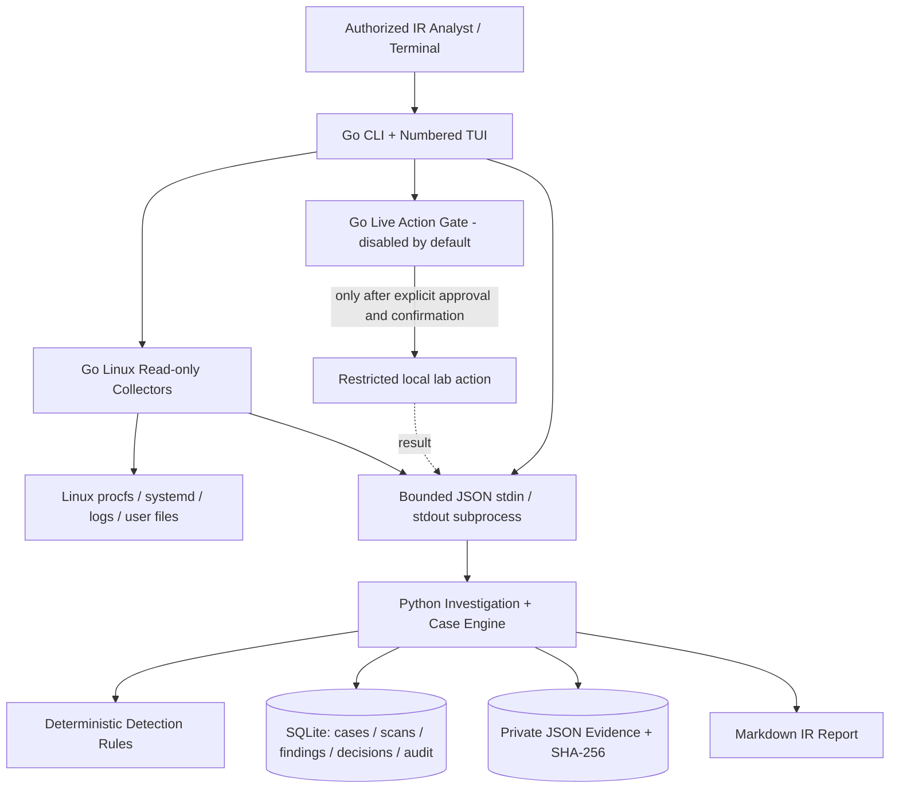
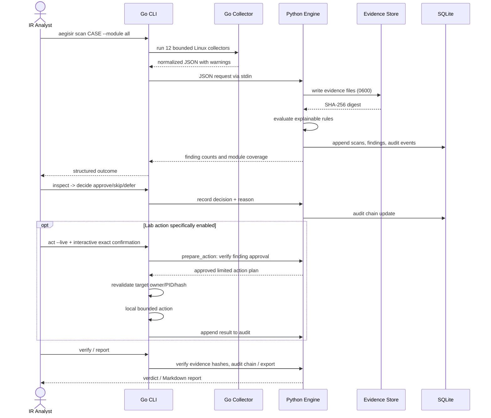
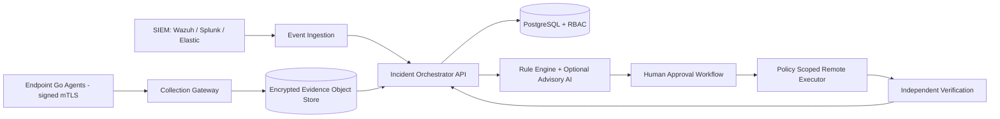

# System Architecture and Working Architecture

## Architecture A — operator and trust boundaries

There is **no network API** and no privileged server in v0.2. Python is a child process of the analyst's Go CLI; both run at the same operator privileges. Live actions are limited to the operator's own temporary artifacts and are disabled by default.

## Architecture B — working data path

## Architecture C — roles of agents

| Logical agent | Running implementation | Write privileges | Safety boundary |
|---|---|---|---|
| Collection agent | Go `internal/collector` | None by design (read-only observations) | Module limits, path caps and subprocess timeouts |
| Detection agent | Python `detect()` | Case evidence/DB only | Deterministic rules, no arbitrary LLM output |
| Explanation agent | Python finding metadata + Go `guide` | Case DB only | Observed evidence and explicit caveats |
| Case agent | Python SQLite workflow | User-owned case directory | Scoped case IDs, auditable updates |
| Decision agent | Python approval record | Case DB | Analyst reason; no automatic execution |
| Response agent | Go `internal/actions` | Two limited lab changes | Non-root operator, ownership, exact PID start time/hash, TTY typed confirmation |
| Verification agent | Python `verify()` + operator re-scan | Case DB and outputs | Local integrity verification; action effectiveness must be independently checked |
| Report agent | Python Markdown exporter | Chosen report path | No overwrite, logged export hash |

**Future independent AI advisory agent** is intentionally disconnected from execution permissions; adding one requires prompt-injection resilience, isolated tools, factual citations to scan IDs and evaluation. Never let model prose directly issue shell commands.

## Architecture D — data and control planes

- **Control plane:** Go CLI/interactive menu, workflow requests and response-authorization controls.
- **Data plane:** Go Linux collectors, JSON evidence capture, Python rule engine, structured SQLite findings.
- **Evidence plane:** case-specific JSON snapshots and SHA-256; local chained audit hashes; Markdown report.
- **Security plane:** user ownership, `umask 077`, bounded reads, no network listener, explicit action approval, refusal of root actions.

## Attack surface and limitations

1. `/proc` and logs are mutable and can be influenced by a local attacker. A post-compromise root attacker may hide, remove or modify observations.
2. Permission limits mean only partial access to other users, firewall policies, secure journals and SSH key directories.
3. A process PID can be reused between validation and signal; the current restricted SIGTERM is not a high-assurance containment primitive.
4. Local JSON hash + SQLite chain is not a cryptographic chain of custody against a privileged local attacker; use external WORM storage, signatures, independent acquisition timestamps and controlled evidence transfers for evidentiary cases.
5. A case still needs incident commander escalation, legal approval and business-impact decisions. The terminal cannot automate human authority.

## Planned enterprise architecture (not implemented)

Before building this, threat-model agent authentication, event provenance, customer data segregation, secrets storage, audit export, rollback and approver independence.
