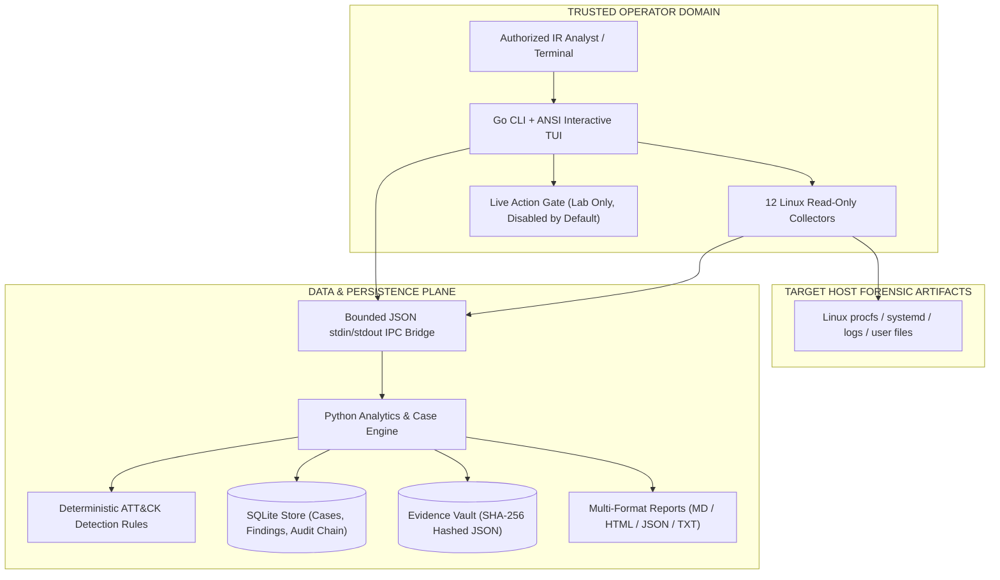
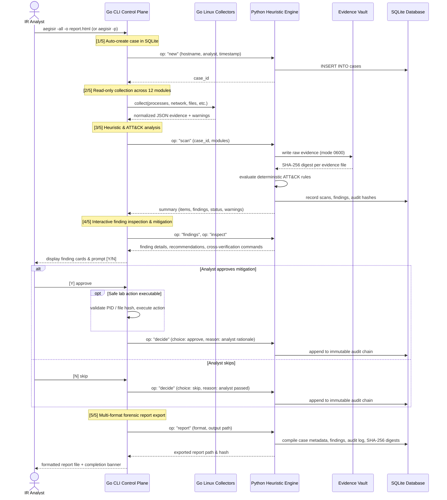

# System Architecture and Component Design

## Architecture A — Operator & Trust Boundaries

There is **no network API** and no privileged server in v0.2. Python is a child process of the analyst's Go CLI; both execute with the operator's unprivileged permissions. Containment actions are restricted to lab artifacts and are disabled by default.

---

## Architecture B — Working Data & Execution Sequence

---

## Architecture C — Roles of Architectural Components

| Component | Implementation | Write Privileges | Safety Boundary |
|---|---|---|---|
| **Collector Engine** | Go `internal/collector/` | None (Read-only observation) | Bounded reads, buffer limits, per-collector timeouts |
| **Detection Engine** | Python `engine.py:evaluate()` | Case evidence / DB only | Deterministic MITRE ATT&CK rules, explainable criteria |
| **Guidance Engine** | Go `cmd/aegisir/guide.go` | None | Built-in offline playbooks with verification commands |
| **Case & Audit Store** | Python SQLite `engine.py` | User-owned directory (`~/.aegisir`) | Scoped case IDs, chained hash integrity |
| **Mitigation Gate** | Go `internal/actions/` | Restricted lab targets only | Refuses root actions, verifies ownership, requires typed confirmation |
| **Report Exporter** | Python `engine.py` | Target file specified by user | Multi-format (.md, .json, .html, .txt), no silent overwrite |

---

## Architecture D — Data & Control Planes

- **Control plane:** Go CLI (`cmd/aegisir/main.go`), numbered ANSI terminal UI (`tui.go`), flag parser, and analyst authorization prompts.
- **Data plane:** 12 Go Linux collectors, JSON serialization, Python rule correlation engine, structured SQLite findings.
- **Evidence plane:** Case-specific JSON snapshots with SHA-256 digests, chained SQLite audit events, exported reports.
- **Security plane:** Per-user file permissions (`0700` directories, `0600` files), `umask 077`, bounded syscalls, zero network listeners, root action refusal.

---

## Attack Surface & Limitations

1. `/proc` and system logs are kernel/filesystem structures and can be manipulated by an attacker who has already obtained root privileges.
2. Unprivileged execution means access is partial for foreign user directories, raw packet sockets, and restricted systemd units.
3. Process PIDs can be reused between validation and signal delivery; lab containment is an educational/testing feature, not an enterprise containment agent.
4. Local evidence hashing provides tamper detection on the machine, but does not substitute for an off-host WORM storage audit archive in legal forensic proceedings.
