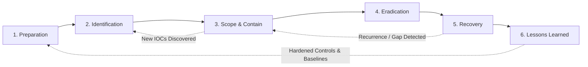
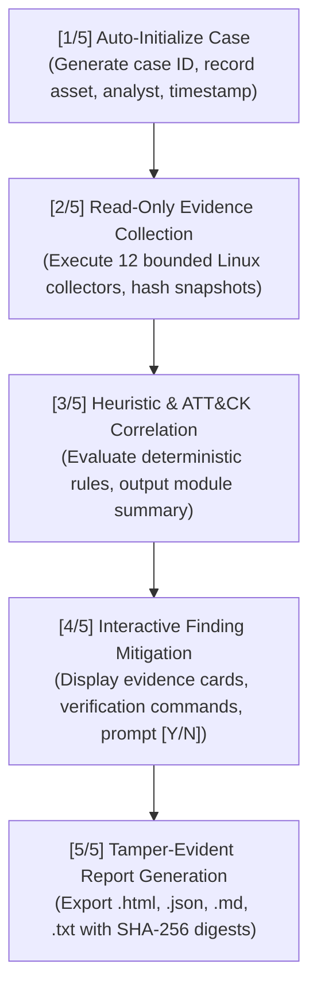
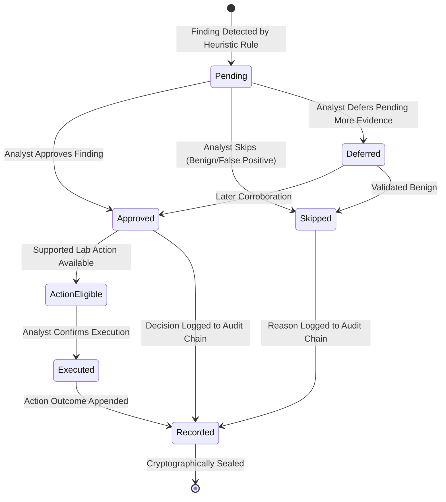

# Incident Response Workflow & Operational Lifecycle

AegisIR implements an automated, analyst-centric incident response triage lifecycle aligned with **NIST SP 800-61 Rev. 3** and the **Cybersecurity Framework (CSF) 2.0**.




---

## 1. Automated 5-Stage Triage Pipeline

When an analyst initiates any scan (e.g. `aegisir -all -o report.html` or `aegisir -p`), AegisIR executes a unified 5-stage automated forensic pipeline:



### Stage 1: Case Initialization `[1/5]`
- Automatically creates a case in local SQLite (`~/.aegisir/case.db`).
- Records target hostname, executing user, timestamp, and default severity (`medium`).
- Assigns a unique tracking identifier (e.g., `IR-B0B8EDBBA6`).

### Stage 2: Read-Only Evidence Collection `[2/5]`
- Runs selected or all 12 forensic modules (`processes`, `files`, `mounts`, `network`, `users`, `services`, `cron`, `ssh`, `profiles`, `logs`, `firewall`, `readiness`).
- Employs strict read-only system calls; bounded buffer limits and per-collector timeouts prevent hanging on slow devices.
- Copies raw evidence into the evidence vault (`mode 0600`) and computes SHA-256 hashes.

### Stage 3: Heuristic & ATT&CK Correlation `[3/5]`
- Evaluates collected evidence against deterministic heuristic detection rules mapped to MITRE ATT&CK techniques.
- Emits a real-time module summary table indicating status (`ok` or `partial`), item count, finding count, and warnings.

### Stage 4: Interactive Finding Review & Mitigation `[4/5]`
- For each detected suspicious indicator, displays an analyst card containing:
  - **Finding ID & Rule Name**
  - **Severity & Confidence Score**
  - **MITRE ATT&CK Mapping** (e.g., `T1059`, `T1543`)
  - **Observed Evidence Detail**
  - **Recommended Cross-Verification Shell Commands** (`grep`, `ss`, `lsof`, `stat`, `systemctl`)
- Prompts the analyst interactively: `Do you want to mitigate this suspicious item? [Y/N]`.
  - **Yes [Y]**: Records an `approve` decision with analyst rationale in the audit trail. If a safe lab action is available (e.g. terminating unlinked process, quarantining temp script), prompts for explicit live execution.
  - **No [N]**: Records a `skip` decision with rationale and returns to the triage flow.

### Stage 5: Tamper-Evident Report Generation `[5/5]`
- Compiles executive summaries, raw module observations, finding cards, and mitigation decisions.
- Embeds SHA-256 evidence digests and SQLite audit hash chains.
- Exports to `.html`, `.json`, `.md`, or `.txt`.

---

## 2. Interactive Terminal UI Workflow (`-ui`)

Running `aegisir -ui` (or launching `aegisir` with no arguments) provides an interactive ANSI menu:

```text
  SELECT AN OPTION:
  ─────────────────────────────────────────────────────────
   [1]  Scan Processes (-p)          (PIDs, unlinked, hidden binaries)
   [2]  Scan Files (-f)              (Executables in /tmp, /var/tmp)
   [3]  Scan Mounts (-m)             (NFS, CIFS, foreign mounts)
   [4]  Scan Network (-n)            (Open ports, active sockets)
   [5]  Full System Scan (-all)      (All 12 modules swept at once)
  ─────────────────────────────────────────────────────────
   [6]  View Incident Cases (-cases) (Browse past investigation records)
   [7]  Case Dashboard (-show)       (3 IR questions & status overview)
   [8]  Case Timeline (-timeline)    (Chronological event audit log)
   [9]  Verify Case Hashes (-verify) (Evidence SHA-256 integrity check)
  [10]  NIST Checklist (-checklist)  (6-phase incident response items)
  ─────────────────────────────────────────────────────────
  [11]  Run Safe Demo (-demo)        (Simulated endpoint compromise)
  [12]  System Doctor (-doctor)      (Check environment readiness)
  [13]  Show Modules (-modules)      (List all collection modules)
  [14]  Help Reference (-help)       (View all flags and syntax)
   [0]  Exit
```

---

## 3. Past Case & Incident Management Workflow

AegisIR provides case management tools for tracking incidents over time:

```bash
aegisir -cases                       # List all historical incidents with severity & status
aegisir -show                        # Case dashboard answering the Three Critical IR Questions
aegisir -timeline                    # Audit trail of all scans, notes, and decisions
aegisir -verify                      # Cryptographically verify evidence SHA-256 digests
aegisir -checklist                   # 6-phase NIST operational checklist
aegisir -report -o report.html       # Export comprehensive forensic report
aegisir -note "Investigated socket"  # Append timestamped analyst note
```

### The Three Critical IR Questions
For every incident case, the case dashboard (`-show`) evaluates:
1. **Is malware active?**
   - Live `/proc` process analysis, anomalous parentage, binaries running from `/tmp` or deleted files (`(deleted)`).
2. **Is there suspicious communication?**
   - Active sockets, listening ports, remote connections, and associated processes.
3. **Is there persistence?**
   - Cron jobs, systemd services/timers, authorized SSH keys, shell startup profiles, and privileged user accounts.

---

## 4. NIST SP 800-61 Phase Mapping

| Phase | Operational AegisIR Capabilities | Primary Commands |
|---|---|---|
| **1. Preparation** | System health verification, NTP audit, permission checks, readiness guide | `aegisir -doctor`, `aegisir -guide readiness` |
| **2. Identification** | 12 read-only collection modules, ATT&CK detection, 3 Critical IR Questions | `aegisir -all`, `aegisir -process`, `aegisir -show` |
| **3. Scope & Containment** | Cross-verification with system tools, evidence hashing, lab isolation | `aegisir -guide [topic]`, `aegisir -cases` |
| **4. Eradication** | Finding evaluation, interactive mitigation approval/skip, lab quarantine | Interactive mitigation prompt, `aegisir -show` |
| **5. Recovery** | Checklist validation, follow-up delta scans, service verification | `aegisir -checklist`, `aegisir -note` |
| **6. Lessons Learned** | SHA-256 cryptographic verification, multi-format forensic reports | `aegisir -verify`, `aegisir -report -o final.html` |

---

## 5. Finding Decision State Machine



---

## 6. Offline Investigation Guides

Analyst playbooks with verification commands and response runbooks:

```bash
aegisir -guide process      # Process triage & memory execution playbook
aegisir -guide file         # Temp file and unauthorized executable investigation
aegisir -guide network      # Socket, port, and connection analysis
aegisir -guide user         # Privilege escalation and rogue account triage
aegisir -guide service      # Systemd service and timer persistence investigation
aegisir -guide cron         # Scheduled job persistence investigation
aegisir -guide ssh          # SSH authorized key forensics and backdoor analysis
aegisir -guide firewall     # Firewall rule tampering and evasion analysis
aegisir -guide logs         # Log review and anti-forensic tampering detection
aegisir -guide readiness    # Incident response readiness and preflight checklist
aegisir -guide workflow     # End-to-end NIST incident handling methodology
```
