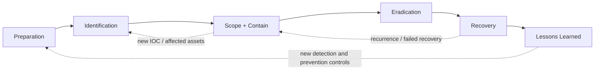
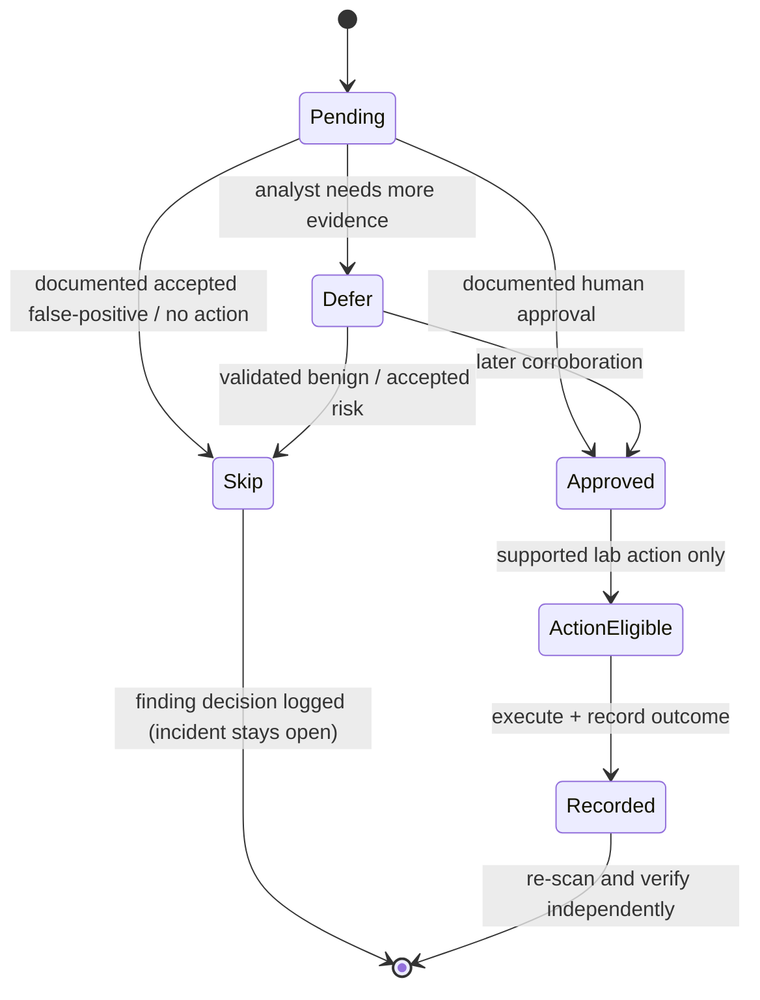

# Complete Incident Response Workflow and Module Mapping

The analyst UI retains **Preparation → Identification → Scope/Containment → Eradication → Recovery → Lessons Learned**. This is a usability-oriented operational grouping mapped to NIST SP 800-61 Rev. 3 / CSF 2.0, **not** a claim that NIST Rev. 3 defines precisely these six sequential phases. Incident tasks can overlap; urgent containment may happen immediately after credible detection.

## 1. Preparation

Document asset owner, communication tree, alternate out-of-band channel, logging/NTP configuration, retention, legal authority, known-good backups, privileged account owners, network routes and escalation matrix. `aegisir guide readiness` and `checklist` assist; **asset inventory, contact sync and trusted baselines are analyst-managed**, not automatically provisioned.

## 2. Identification

Capture alert context, assign lead, decide whether it is an incident, establish initial time range. Use `new`, `scan`, `findings`, `inspect`, `show`, `note`. Ask:

- **Malware active?** Check live processes, command-lines, executable provenance and forensic acquisition.
- **Suspicious communication?** Analyze sockets, service owners, SIEM/network flow and traffic capture. A listener or odd port alone is not malicious.
- **Persistence?** Check cron, systemd services/timers, authorized keys, shell profiles and privileged accounts.

The system reports `review_indicators` vs `unverified` instead of false `clean` verdicts.

## 3. Scope, impact and time-critical containment

Establish affected assets/users, lateral spread, remote shares, leaked data, attacker timeline and business impact. If an attack is actively propagating, incident commander can approve emergency isolation before the entire forensic scope is mapped; record the deviation and evidence implications. In v0.2, **isolation, network blocking and user disabling are manual/external playbook operations**; the CLI does not claim to execute them.

## 4. Eradication

Correlate evidence, confirm root cause, identify and remove unauthorized persistence, patch exploitation path, rotate compromised secrets, restore trusted config. Each finding has a recommendation and an analyst decision. No blanket killall, userdel, sudoers edits, bulk SSH key removal or rm -rf is implemented. Lab-only SIGTERM and file quarantine exist with restricted preflight checks.

## 5. Recovery

Validate restored service identity, app/database health, credentials, logs, backup integrity, business signoff, follow-up observation and recurrent IOC searches. **Automated restore and continuous monitoring are not implemented**. Use checklist with supporting notes, new scans and incident runbooks.

## 6. Lessons learned and report

Capture timeline, evidence gaps, decision delays, detection improvements and preventive controls; run `verify`, export report, collect review signatures externally. Closure requires completed checklist items, assessed findings and passing local integrity check. Closure means documented analyst acceptance, not forensic proof that the adversary is gone.

## Linux artifact modules

| Module | Observations | Examples of suspicious hypotheses | Action status |
|---|---|---|---|
| readiness | Host, NTP, log visibility | Clock/logging gap | Advise |
| users | passwd, group memberships | Non-root UID 0; web account privileged | Advise |
| processes | PID, PPID, UID, EXE, cmdline | Temp executable, download-to-shell | Restricted lab SIGTERM on qualifying finding |
| files | Temp scripts/executables, metadata, hashes | Unknown executable in writable path | Restricted lab same-FS quarantine |
| mounts | /proc/mounts | NFS/CIFS share in affected scope | Advise |
| network | TCP/UDP socket metadata, PID when available | Non-baseline listener | Advise |
| firewall | nftables/iptables rules when accessible | Collection gaps, unauthorized rules requiring baseline | Advise |
| services | unit files, ExecStart, enabled state, timers | Temp execution or unauthorized service | Advise |
| cron | crontab/system cron | cron from temp, curl/wget shell | Advise |
| ssh | Authorized-key SHA256 fingerprints | Unknown privileged key | Advise |
| profiles | Bounded suspicious shell init lines | Invocation of temp scripts, download shell | Advise |
| logs | journalctl/auth logs bounded | Repeated SSH failure log events | Advise |

## Decision state machine

## Built-in tutorials

`aegisir guide workflow` or `aegisir guide users|processes|files|mounts|network|firewall|services|cron|ssh|profiles|logs|readiness` provides offline, terminal-readable investigation purpose, what gets collected, what warrants review and recommended response cautions.
